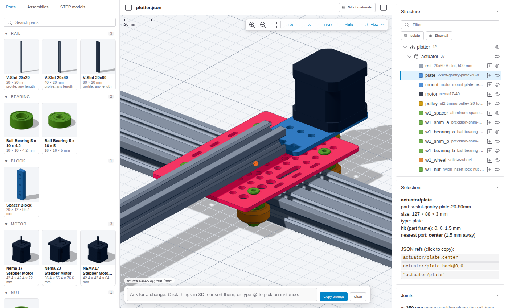
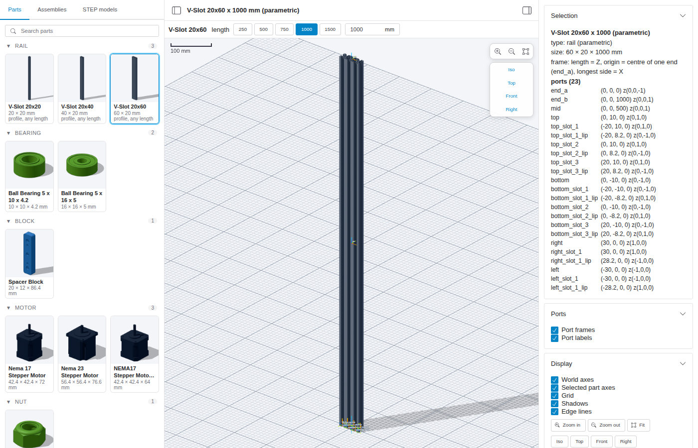

# OpenBuilds Studio

A virtual assembly of a table-top pen plotter made from OpenBuilds parts, built before buying the hardware. It is used to check fit, axis travel and collisions, and to get a bill of materials.

Assemblies are JSON files (`assemblies/*.json`) edited by an AI agent (Claude Code) and checked by a solver. The browser viewer is for looking and pointing only; it never edits geometry. See [HANDOFF.md](HANDOFF.md) for the details and [VOCABULARY.md](VOCABULARY.md) for the assembly language.



## Quick start

```sh
npm install
npm run dev            # viewer at http://localhost:5173
node tools/solve.mjs assemblies/plotter.json                     # solve, BOM, mounts
node tools/snap.mjs assemblies/plotter.json --view iso,top,front # PNG snapshots in snaps/
```

Other commands:

| Command | What it does |
|---|---|
| `npm run convert` | STEP / STL files in `parts/` → GLB models in `models/` |
| `npm run library` | `models/` → deduplicated library parts with ports in `library/` |
| `npm run thumbs` | thumbnails for parts, assemblies and models (`--force` to redo all) |
| `npm run build` | static viewer in `viewer/dist` |

## Viewer

- **Left:** a browser with Parts, Assemblies and STEP models tabs, with search, thumbnails and collapsible groups.
- **Centre:** an orthographic 3D view with shadows and a scale bar. A toolbar at the top right holds zoom/fit, Iso/Top/Front/Right and a **View** dropdown (axes, grid, shadows, edge lines, port markers; remembered in localStorage).
- **Right:** the assembly and part info. **Structure** tree (assembly > sub-assemblies > instances, with hide/isolate, filter and insert-in-prompt; synced with 3D clicks and hover), selection info with copy-ready references, joint sliders and mounts.
- **Bottom:** a prompt box. Click parts, faces, edges or holes in 3D to insert them as chips, then copy the prompt into Claude Code.

| Plotter (snapshot tool) | Bill of materials |
|---|---|
|  |  |

| Parametric rail with standard lengths | Real V-slot 20x20 profile |
|---|---|
|  |  |

## Agent loop

1. In the viewer, type a request and click the pieces it refers to.
2. Press **Copy prompt** and paste it into Claude Code.
3. The agent edits the assembly JSON, checks it with `tools/solve.mjs` and looks at `tools/snap.mjs` snapshots.
4. The viewer reloads live.

## Sources and licenses

Part models are GrabCAD / Printables downloads in `parts/`, which is not tracked by git. The OpenBuilds SCRIBE pen lifter (Printables) is licensed CC BY-NC-ND 4.0: do not redistribute its derived library parts.
