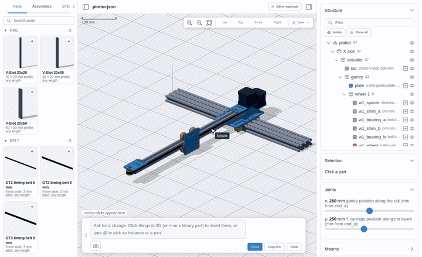
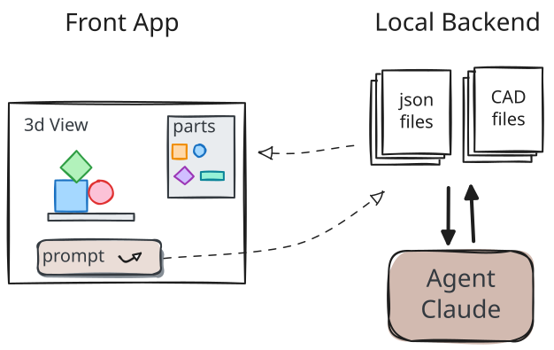
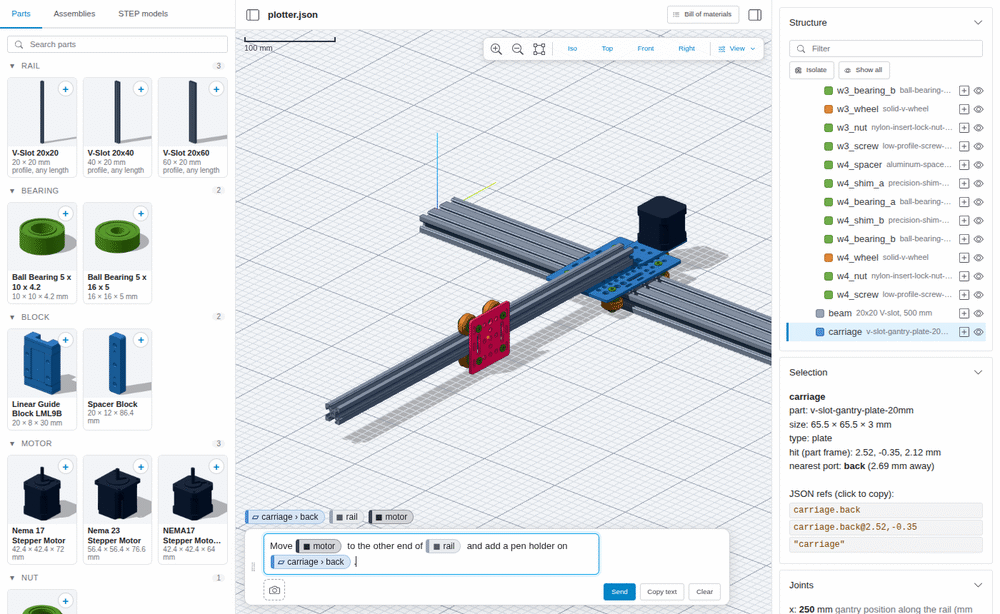
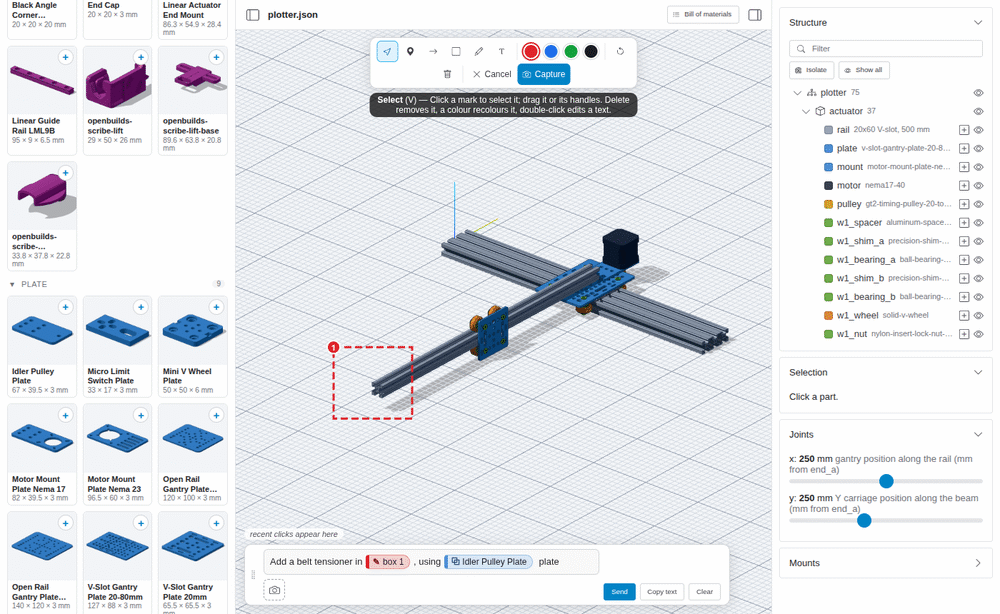
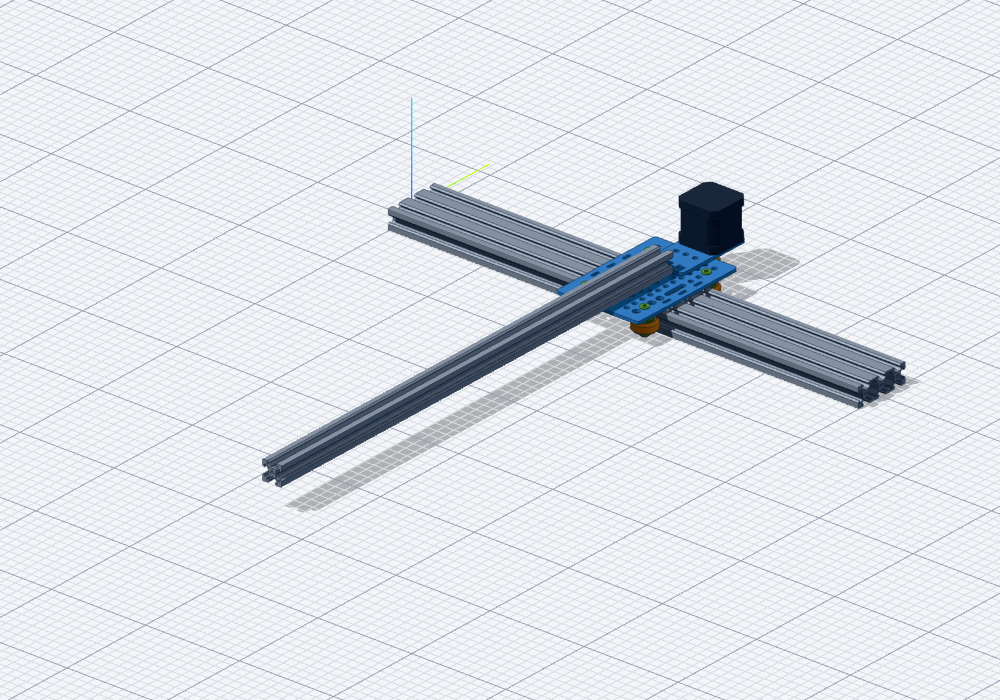
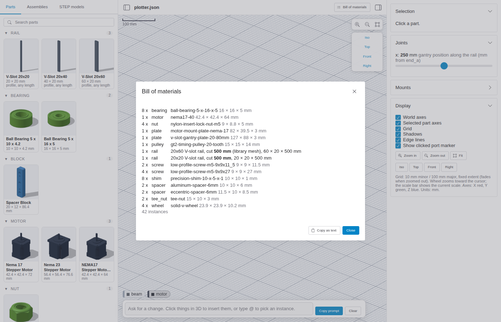
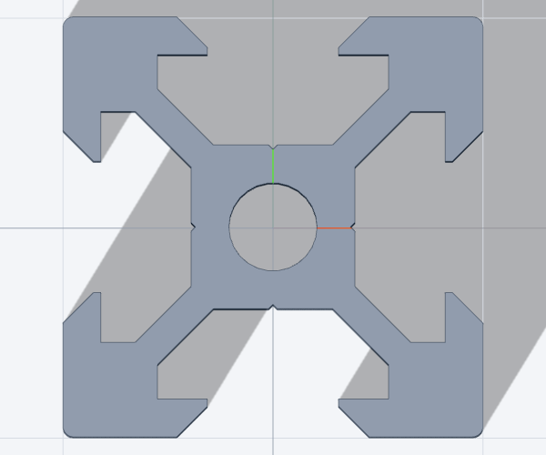

# Agentic Open Builder

Design a machine from OpenBuilds parts by talking to an AI agent. Point at parts in a 3D viewer, describe the change, and Claude Code edits the assembly. A solver checks fit, axis travel and collisions, and produces the bill of materials, all before you buy any hardware.

The example project is a table-top pen plotter.



([MP4 version](docs/demo/demo.mp4); re-record with `node tools/demo_anim.mjs --gpu`)



- **Assemblies** are JSON files (`user_data/assemblies/*.json`) written in a small assembly language ([docs/VOCABULARY.md](docs/VOCABULARY.md)).
- **The agent** (Claude Code) edits them and runs the solver to check its work.
- **The viewer** is for looking and pointing only; it never edits geometry.



## Prompts and the agent loop

1. **Point.** Type a request in the prompt box, then click parts, faces, edges or holes in 3D (or a library card's **+**) to insert them as chips.
2. **Draw (optional).** Take a screenshot with the camera button. The view freezes and you can add pins, arrows, boxes, freehand and text; each mark is numbered so the prompt can refer to it.
3. **Send.** The prompt and screenshots are saved to `user_data/prompts/<date>/`, and a `Read …/prompt.md` line is copied. Paste it into Claude Code. (**Copy text** copies the prompt without screenshots and works without the dev server.)
4. **Agent works.** It edits the assembly JSON, runs `tools/solve.mjs`, and looks at `tools/snap.mjs` snapshots.
5. **Viewer reloads** live.

### Example

Prompt: *Add a belt tensioner in* «box 1»*, using* «Idler Pulley Plate» *plate*. «box 1» is a box drawn at the free end of the beam; the plate comes from its library card.



The `prompt.md` the agent reads:

```text
[plotter viewer] assembly: user_data/assemblies/plotter.json   state: {"x":250,"y":250}
Request: Add a belt tensioner in «box 1» , using «Idler Pulley Plate» plate
References:
- «box 1» = img:mwerujqniphg#1  mark 1 on image 1 (red box, described under Screenshots)
- «Idler Pulley Plate» = lib:idler-pulley-plate  library part idler-pulley-plate (user_data/library/idler-pulley-plate/part.json), type plate, 67 × 39.5 × 3 mm
(lib:<slug> = a library part, used in the assembly JSON as {"part": "<slug>"}; lib:vslot-<profile> = a parametric V-Slot rail)
Screenshots (open each one with the Read tool; orthographic views, so the scale is the same everywhere in an image):
- user_data/prompts/2026-11-13_102625/1.png — 1029×886 px, assembly: user_data/assemblies/plotter.json; looking from iso [0.57, -0.68, 0.46] at [250.0, -187.3, 24.0] mm (image centre), 0.794 mm per px
  Marks drawn on it (3D points in mm, world frame):
    1. red box around «beam»; centre on «beam» at [241.8, -478.4, 35]; image px (211, 501)–(333, 611)
Read docs/VOCABULARY.md, edit the assembly JSON, run `node tools/solve.mjs <file>` to check it.
```

Chips become named references, and drawn marks are turned into 3D points (here: around `beam`, centre at [241.8, -478.4, 35] mm), so the agent knows where to work without guessing from pixels.

## More screenshots

| Plotter (snapshot tool) | Bill of materials |
|---|---|
|  |  |

| Parametric rail with standard lengths | Real V-slot 20x20 profile |
|---|---|
|  |  |

Viewer layout:

- **Left:** Parts, Assemblies and STEP models, with search and thumbnails.
- **Centre:** orthographic 3D view; zoom/fit, Iso/Top/Front/Right, and a **View** menu (axes, grid, shadows, edges, port markers).
- **Right:** **Structure** tree (hide, isolate, insert in prompt; synced with 3D), selection info, joint sliders and mounts.
- **Bottom:** the prompt box.

## Usage

```sh
npm install
npm run dev            # viewer at http://localhost:5173
node tools/solve.mjs user_data/assemblies/plotter.json                     # solve, BOM, mounts
node tools/snap.mjs user_data/assemblies/plotter.json --view iso,top,front # PNG snapshots in user_data/snaps/
```

A fresh clone has an empty viewer. Put CAD files (STEP / STL) in `user_data/parts/`, then:

```sh
npm run convert   # STEP / STL → GLB models in user_data/models/
npm run library   # models → deduplicated library parts with ports in user_data/library/
npm run thumbs    # thumbnails (--force to redo all)
```

| Other commands | |
|---|---|
| `npm run build` | static viewer in `viewer/dist` |
| `node tools/readme_shots.mjs` | retake the screenshots in `docs/screenshots/` |

### `user_data/`

All CAD-derived files and your own assemblies live in `user_data/`, which git ignores (set `USER_DATA=<dir>` to move it):

```
user_data/
  inbox/        raw downloads (zips)
  parts/        unpacked STEP / STL
  models/       converted GLB + catalog.json
  library/      built parts (part.glb, part.json, thumb.png) + index.json
  assemblies/   assembly JSON files
  prompts/      prompts sent from the viewer
  snaps/        snapshot output
```

More details: [docs/HANDOFF.md](docs/HANDOFF.md). Ideas, open issues and a record of finished work: [backlog/](backlog/README.md).

## License

Code: MIT, see [LICENSE](LICENSE).

Part models (GrabCAD / Printables downloads) are not included; they and everything derived from them stay in `user_data/` under their own licenses. The OpenBuilds SCRIBE pen lifter (Printables) is CC BY-NC-ND 4.0.
