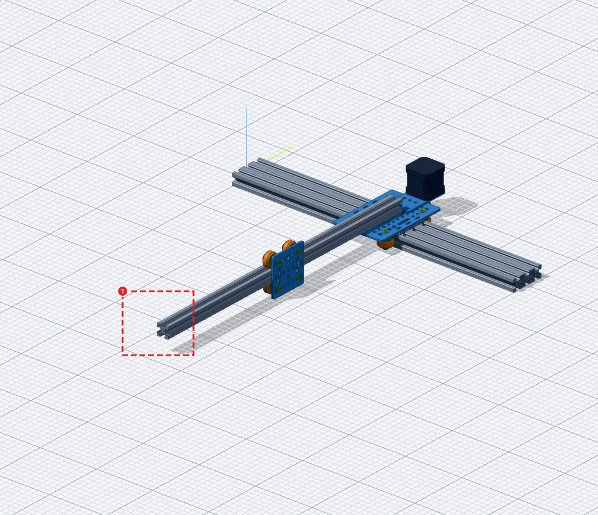
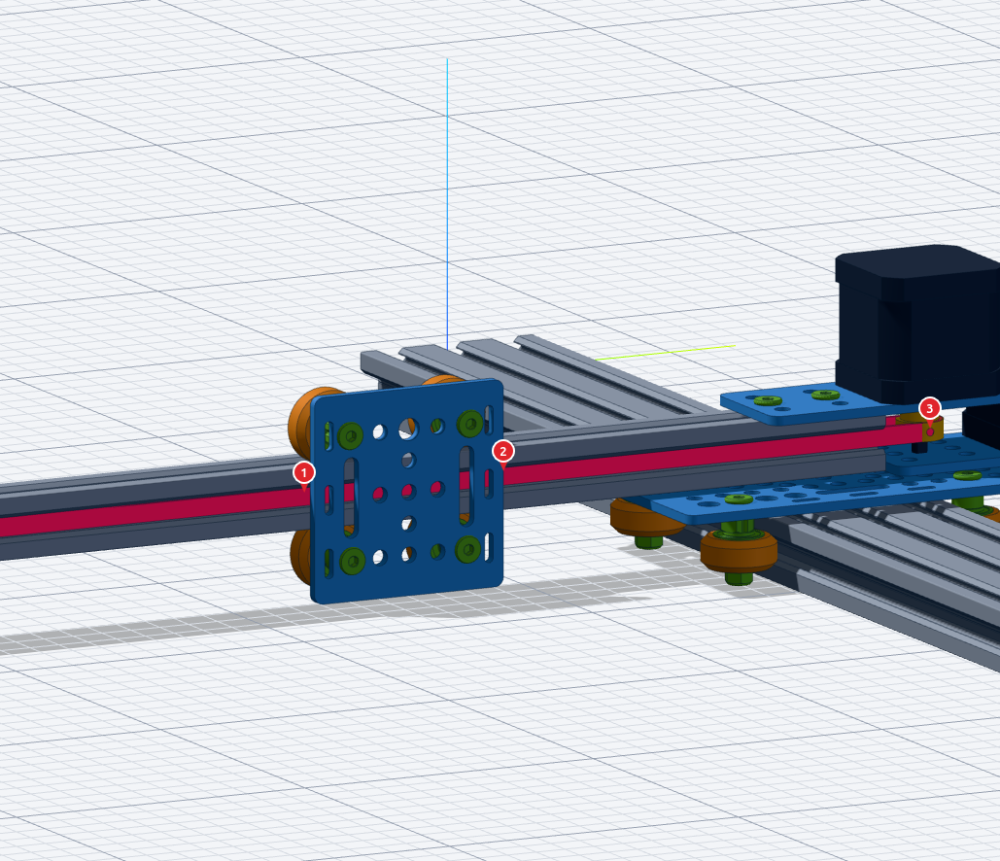
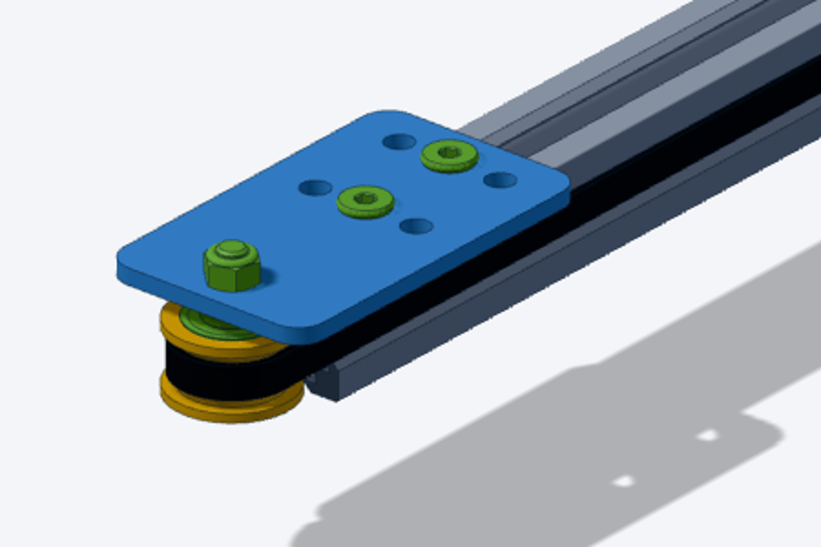
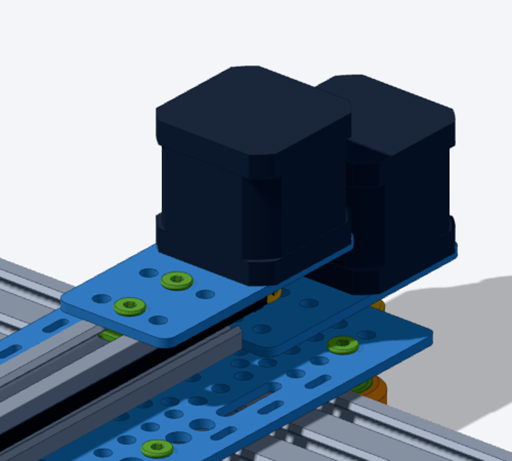
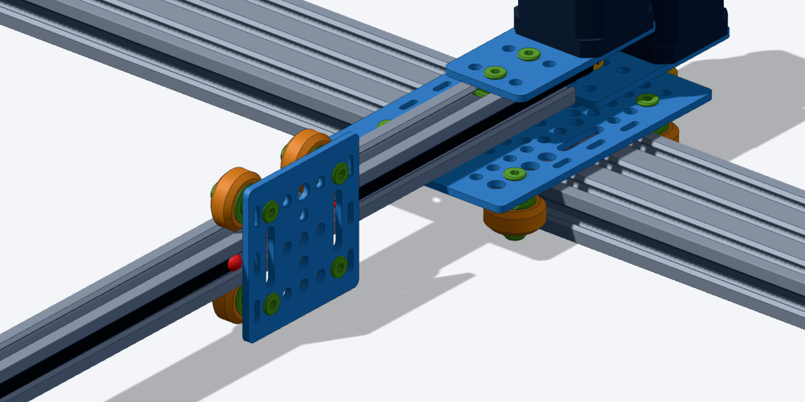
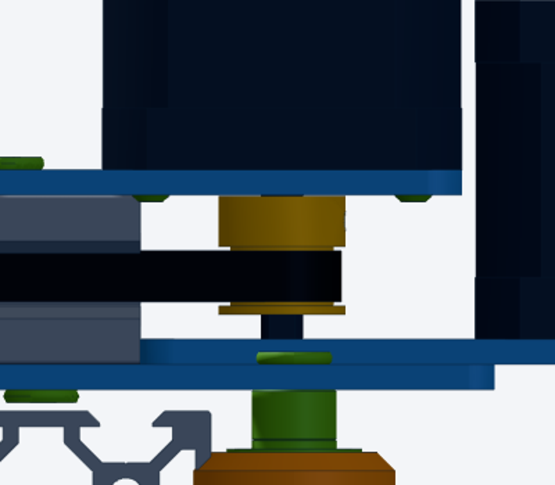

## Context

`plotter.json`: a 20x20x500 beam (`beam`) bolted on the X gantry plate, with a Y carriage (`carriage`, 20 mm gantry plate on 4 V-wheels) on its right face. No Y drive yet. Prompts:

- 2026-11-13_113229: "Add a belt tensioner in «box 1», using «Idler Pulley Plate» plate" (box at the beam front end), plus a reference picture of the OpenBuilds idler plate kit.
- 2026-11-13_115942: "belt start at «pointer 1» go to the tension pulley, then to the motor «pointer 3», and back to the plate «pointer 2»".
- 2026-11-13_120853: "the belt should go around the «y pulley»" (the wrap was hidden, see 0002).

## Outcome

**Assembly** (`user_data/assemblies/plotter.json`), layout copied from the OpenBuilds NEMA17 belt-driven actuator STEP (`user_data/models/actuator_nema17_belt_driven_500`):

- Tensioner at `end_b`: `y_idler_plate` (idler-pulley-plate) on the beam top, 13.2 mm in from the end, 2 M5x9.5 low-profile screws into a double tee nut; under it 3 mm spacer, bearing, 1/8in nylon spacer, bearing (inside `y_idler`, smooth idler pulley), M5x26.5 + lock nut. Pulley axis 13.3 mm beyond the beam end.
- Y motor at `end_a` (user's choice among: second idler / motor at end_a / belt-and-pinion): `y_motor_mount` (NEMA17 mount plate) on the beam top, `y_motor` (nema17-40) body up, 4 M3 screws, `y_pulley` GT2 20T hub up, teeth on the belt plane. Plate shifted 2 mm onto the beam vs the STEP so the Y motor body clears the X motor (1.6 mm).
- `y_belt`: gt2-belt-6mm, open, from `carriage.edge_+y` round `y_idler` and `y_pulley` to `carriage.edge_-y`, horizontal in the beam left / right slots. **Cut length 1044.3 mm** (loop 1109.8 minus the 65.5 mm plate), constant over the Y travel.
- Y travel range reduced to 120..420 (top wheels and plate stop before the idler plate).

**Code**: belts are parametric source parts.

- [lib/belt.js](../../../lib/belt.js): belt catalogue (`gt2-belt-6mm`, `gt2-belt-9mm`, `gt3-belt-9mm`: profile, pitch, width, thickness, material), `beltDef`, pulley seats, convex loop, open-belt cut.
- [lib/assembly.js](../../../lib/assembly.js): `belts` verb (`part`, `around`, `from` / `to`), solved after mates and mounts; BOM row `<part> x <length>`.
- [viewer/belt.js](../../../viewer/belt.js): swept band mesh, end caps, red clamp spheres; re-built when the carriage moves ([viewer/buildmode.js](../../../viewer/buildmode.js)). Parts tab cards and `lib:gt2-belt-6mm` chips ([viewer/main.js](../../../viewer/main.js)), thumbnails from tools/snap.mjs.
- [tools/solve.mjs](../../../tools/solve.mjs) prints the belt, clamps, wraps and spans; docs in [docs/VOCABULARY.md](../../../docs/VOCABULARY.md).

Checked with `node tools/solve.mjs` (no warning, y = 120 and 420) and snapshots:

**Left open**: Y motor shaft collides with the X motor mount plate (0003); belt clamp hardware not modelled; general belt routing (0002).
