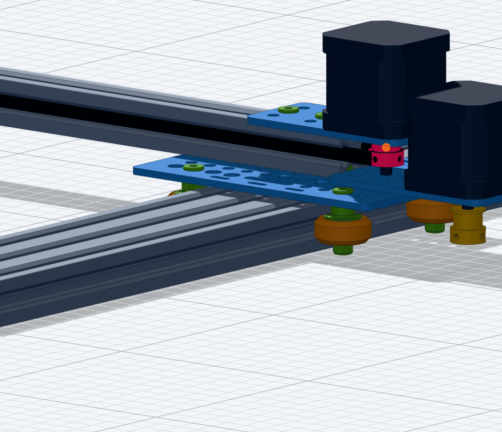

## Context

The `belts` verb ([lib/assembly.js](../../../lib/assembly.js), geometry in [lib/belt.js](../../../lib/belt.js), mesh in [viewer/belt.js](../../../viewer/belt.js), documented in [docs/VOCABULARY.md](../../../docs/VOCABULARY.md)) routes a belt around pulleys:

- **Handled:** any number of coplanar pulleys, all wrapped on the outside of the belt (a convex loop); an endless loop, or an open belt cut at two clamp ports (`from` / `to`) lying on the same straight run. The belt is re-solved with the joints (it follows the carriage), its length goes to the BOM (`gt2-belt-6mm x 1044.3`), and a pulley off the belt plane gives a warning.
- **Not handled:**
  - a pulley or idler pressing on the **back** of the belt (wrap in the other direction: serpentine, tensioner idler on the outside);
  - **belt ends fixed to the frame** instead of lying on a loop. The X axis (`actuator_2060_500.json`) is a belt-and-pinion: the belt is fixed at both rail ends, lies in a rail slot and leaves it in an omega around the motor pinion. The OpenBuilds STEP (`user_data/models/actuator_2060_500`) has it as "GT2 Belt 585mm" for a 500 mm rail;
  - clamps on different runs; twisted or non-planar belts.

Pulley seats are also guessed per part (`beltSeat` in lib/belt.js). The GT2 20T one was wrong at first: the belt sat in the hub (r 7.5) instead of the teeth, so the wrap round `y_pulley` was hidden and looked like two belts (prompt below, fixed 2026-11-13 by measuring the mesh: flange z -7..-6, teeth -6..+1, hub +1..+7).



## Proposal

Describe a belt as an ordered **route** of waypoints; the solver joins consecutive waypoints with the right tangent:

```json
"belts": [{ "name": "x_belt", "part": "gt2-belt-6mm",
  "route": [ {"at": "rail.top_slot_2@0"},
             {"pulley": "pulley", "wrap": "cw"},
             {"at": "rail.top_slot_2@500"} ] }]
```

- waypoint = a pulley with a wrap direction (`cw` / `ccw`, seen from the first pulley axis), or a fixed point `at` a port (a circle of radius 0: rail end, clamp);
- same wrap on both pulleys = outer tangent, opposite wraps = crossed tangent (standard construction, about 40 lines in lib/belt.js);
- `closed: true` for an endless loop (the current `around` becomes a shortcut for an all-`ccw` closed route; `from` / `to` stay as clamps cut out of a closed route);
- output unchanged: centre-line path, length (BOM cut length), mesh, clamp spheres.

Escape hatch, only for what a route cannot express: `"generator": "belts/<name>.js"`, a pure function `(ports, state) => { path, length }` that receives **solved** port positions (so it follows the assembly) and feeds the same mesh / BOM pipeline. Discussed and preferred over agent-written per-belt mesh code `belt_Y(carriage_position) -> mesh`, which hard-codes positions (goes stale when a pulley moves), must compute its own BOM length, and fails silently instead of with a solver error.

Also: store the belt seat in the pulley part data (`belt_seat: {radius, offset}` in part.json) instead of slug rules, measured once per pulley.

## Acceptance

- [ ] `route` with `cw` / `ccw` pulleys and `at` points in lib/belt.js + lib/assembly.js; `around` / `from` / `to` still work (plotter Y belt unchanged: cut length 1044.3 mm)
- [ ] X belt on `actuator_2060_500.json` (belt-and-pinion omega round `pulley`); its length compared with the STEP "GT2 Belt 585mm"
- [ ] a wrong route (pulley overlap, unreachable tangent) fails with a message naming the waypoint
- [ ] docs/VOCABULARY.md `belts` section updated, with the X belt as an example
- [ ] belt seats in part.json for the GT2 / GT3 pulleys and the smooth idler

## Log

- 2026-11-13: issue created after the Y belt (0001). Generic custom-code generator discussed, kept only as an escape hatch.
