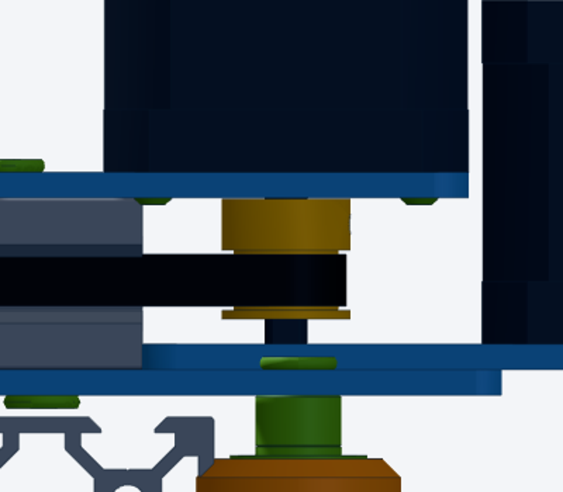
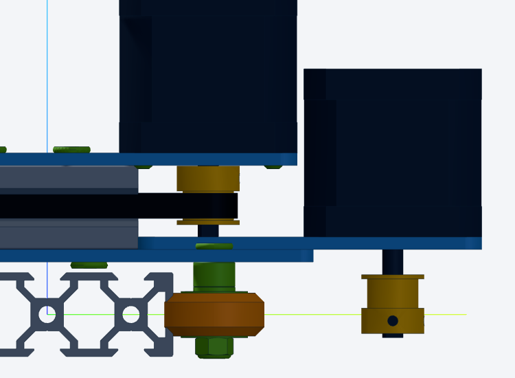

## Context

Problems in an assembly are found today in three places, none of them visible where the user looks:

- **solver**: `node tools/solve.mjs` prints `WARNING:` lines (`res.warnings` in [lib/assembly.js](../../../lib/assembly.js): joint clamped to its range, mate loop misfit, belt pulley off the belt plane, clamp far from the belt). The viewer only shows errors (`#b-err`), not warnings;
- **agent**: Claude finds clearances by hand while editing, and reports them in the chat only (lost afterwards);
- **nobody**: there is no collision check, so real clashes go unnoticed.

Example found on the plotter (2026-11-13, issue 0001): the Y motor (`y_motor`, nema17-40, 24 mm shaft) sits on the beam top at z 38.5 with the shaft down; the shaft tip reaches z 14.5, through the X motor mount plate (`actuator/mount`, z 15.5..18.5). About 4 mm of interference, seen only on a close-up render. Other tight spots noted by hand: Y motor body 1.6 mm from the X motor; Y pulley 2.9 mm above `actuator/mount`.





## Proposal

One list of findings per assembly, shown in the viewer, coming from two sources:

1. **Solver findings** (computed on every solve, so they follow the sliders): `res.warnings` turned into objects
   `{level: "error"|"warning"|"info", kind: "collision"|"clearance"|"range"|"belt"|..., parts: ["y_motor", "actuator/mount"], at: [x,y,z], value: -4.0, text}`.
   New checks: a collision / clearance pass over instance bounding boxes (oriented boxes first; mesh-level later), skipping parts that are mated together (screw in its hole, nut on its screw), with a `min_clearance` (default 1 mm).
2. **Agent findings**, written into the assembly JSON so they persist and are versioned with it:
   ```json
   "findings": [{ "level": "warning", "kind": "collision", "parts": ["y_motor", "actuator/mount"],
                  "at": [250, 38.4, 16], "text": "24 mm shaft goes ~4 mm into the X motor mount plate: trim the shaft or use a short-shaft motor",
                  "by": "agent", "date": "2026-11-13" }]
   ```
   `tools/solve.mjs` prints them with the solver ones.

In the viewer (Build tab):

- a **Warnings** badge with a count (red for errors), opening a list; each row: level icon, text, part chips;
- click a row: highlight the parts, fly to `at`, put a marker there;
- optional overlay: red / orange markers in 3D at each `at`;
- a row can be inserted in the prompt as a chip ("fix «warning 2»"), like a part.

## Acceptance

- [ ] `res.warnings` become structured findings; old string warnings still printed by solve.mjs
- [ ] `findings` key in the assembly JSON documented in docs/VOCABULARY.md and printed by solve.mjs
- [ ] Build tab shows the count and the list; click = highlight + fly to
- [ ] a bounding-box collision / clearance check reports the Y motor shaft vs `actuator/mount` on plotter.json
- [ ] finding chips in the prompt (`«warning 2»` with its text and parts in the References)

## Log

- 2026-11-13: issue created. Shaft collision found while checking the Y belt wrap (0001).
